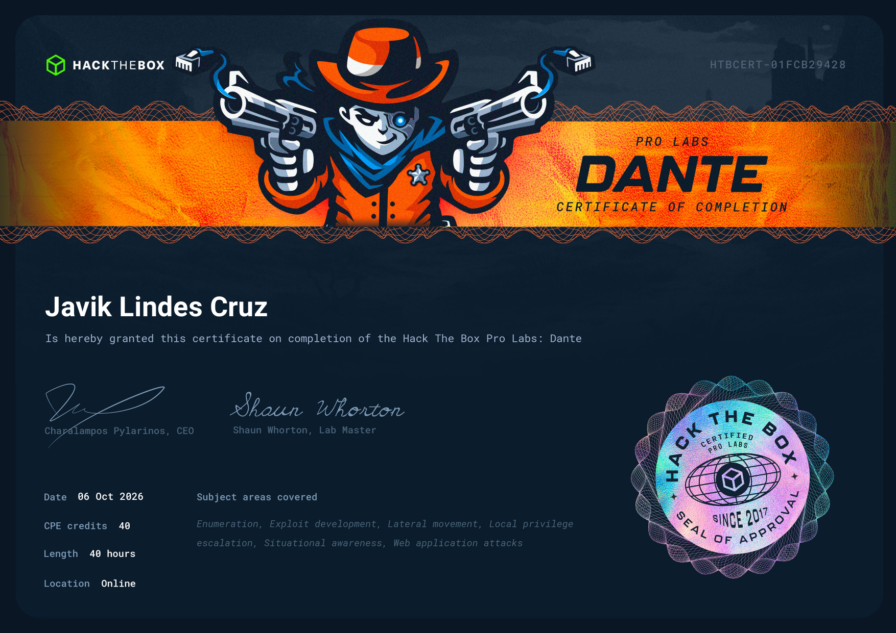
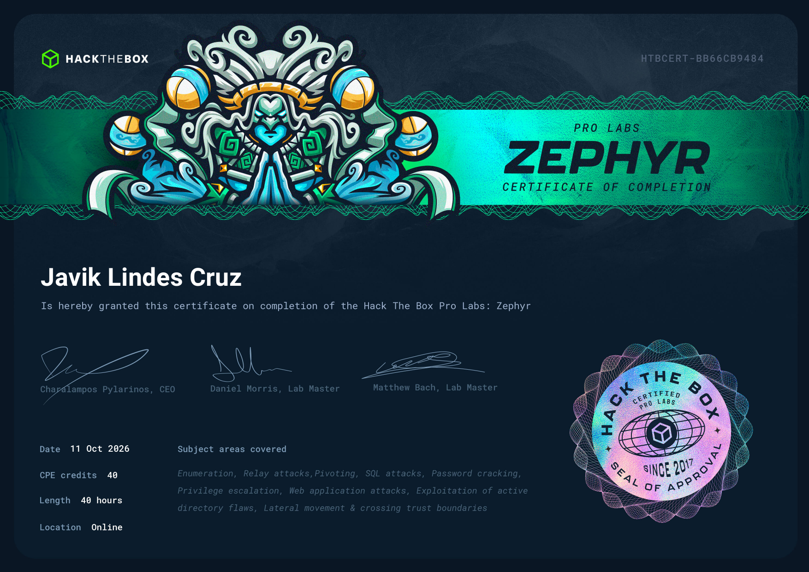
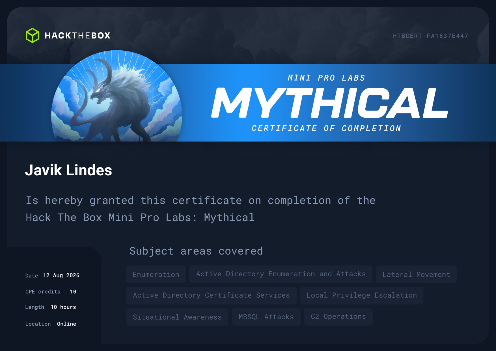
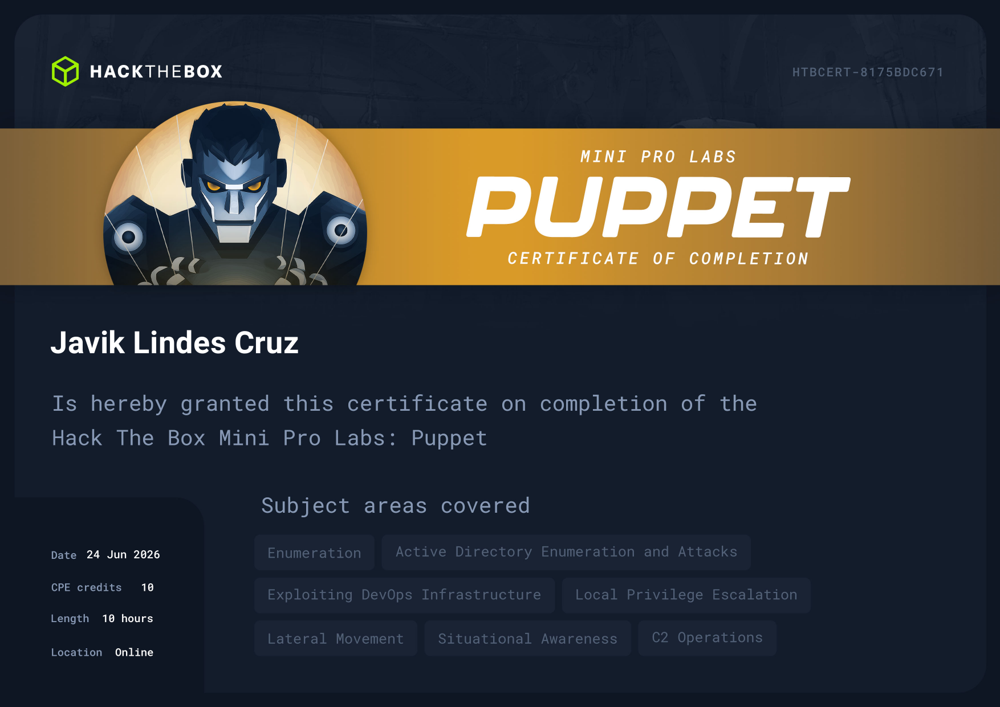

# 🏆 Certificaciones y Laboratorios

Seguimiento de rutas de estudio, acreditaciones profesionales y progreso en entornos empresariales simulados de Hack The Box y CyberWarFare Labs.

---

## 📜 Certificaciones

Acreditaciones profesionales y certificaciones de seguridad ofensiva obtenidas.

| Certificación | Emisor | Estado | Credencial ID | Enfoque principal |
| :--- | :--- | :--- | :--- | :--- |
| **CRTA (Certified Red Team Analyst)** | CyberWarFare Labs | :white_check_mark: **Obtenida** | `CRTA-6acf05e7a8a9c04132dc91f9` | Active Directory Attacks, Red Teaming, Kerberos, Lateral Movement, Post-Explotación |

### Certificados Oficiales

-   __CRTA — Certified Red Team Analyst (CyberWarFare Labs)__

    ---

    

---

## ⚡ ProLabs (Hack The Box)

Entornos empresariales completos simulados a gran escala para auditorías de Active Directory, pivoting avanzado y post-explotación corporativa.

| ProLab | Dificultad | Tecnologías y Vectores | Progreso | Certificado |
| :--- | :--- | :--- | :--- | :--- |
| **Dante** | Media | Linux, Windows, Active Directory, Pivoting, Explotación Web | :white_check_mark: **Completado (100%)** | `HTBCERT-01FCB29428` |
| **Zephyr** | Difícil | Active Directory, Kerberos, Pivoting avanzado, C2, Evasión | :white_check_mark: **Completado (100%)** | `HTBCERT-BB66CB9484` |

### Certificados de Finalización ProLabs

-   __Dante — Certificate of Completion__

    ---

    

-   __Zephyr — Certificate of Completion__

    ---

    

---

## 🧪 Mini ProLabs

Escenarios prácticos focalizados y retos tácticos empresariales completados en Hack The Box.

| Mini ProLab | Plataforma | Estado | Enfoque principal |
| :--- | :--- | :--- | :--- |
| **Mythical** | Hack The Box | :white_check_mark: **Completado (100%)** | Active Directory, Pivoting, C2, Explotación avanzada |
| **Puppet** | Hack The Box | :white_check_mark: **Completado (100%)** | Active Directory, C2, Gestión de identidades, PrivEsc |

### Certificados de Finalización Mini ProLabs

-   __Mythical — Certificate of Completion__

    ---

    

-   __Puppet — Certificate of Completion__

    ---

    

