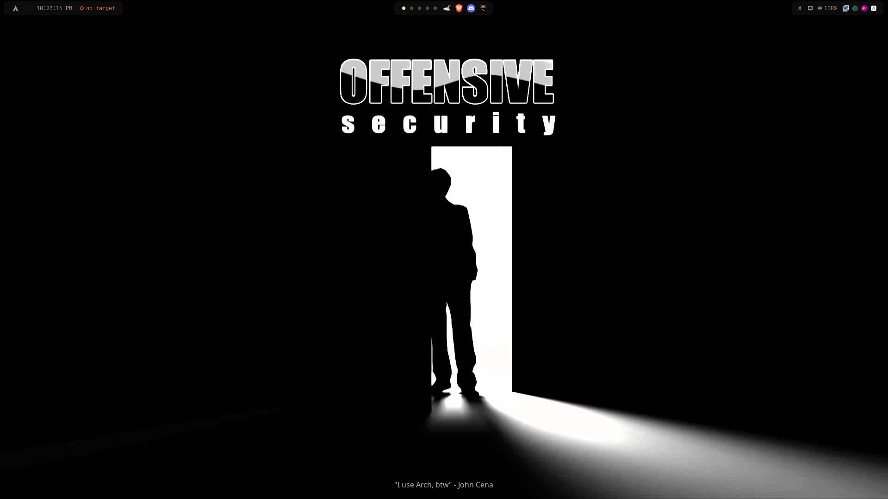
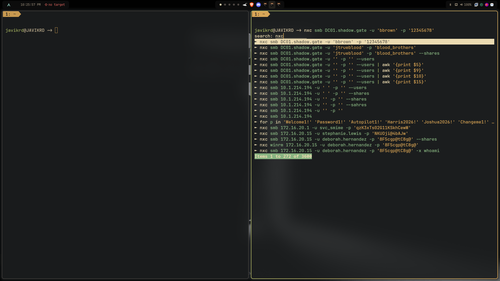

# 🖥️ Mi Entorno de Trabajo

Configuración personalizada de mi estación de trabajo sobre **Arch Linux** optimizada para auditorías de Active Directory, pentesting corporativo y seguridad ofensiva.

<div style="margin: 1.5rem 0;">
  <a href="https://github.com/JAVIKRD/dotfiles" target="_blank" class="md-button md-button--primary">
    :fontawesome-brands-github: Ver Repositorio de Dotfiles en GitHub
  </a>
</div>

---

## 📸 Capturas de Pantalla

### 🖥️ Escritorio Principal
Entorno minimalista sobre **Hyprland** (Wayland) con **Waybar** superior integrada, wallpaper de *Offensive Security* y gestión limpia de ventanas.



---

### 💻 Terminal y Flujo de Trabajo Ofensivo
Terminal **Kitty** con **Fish Shell**, **Starship Prompt** y **Tmux**, aprovechando búsqueda inversa difusa (*fuzzy search*) para comandos de reconocimiento y explotación de Active Directory con **NetExec (NXC)**.



---

## ⚙️ Stack y Componentes del Sistema

| Componente | Herramienta | Descripción |
| :--- | :--- | :--- |
| **Sistema Operativo** | **Arch Linux** | Base rolling-release ligera, actualizada y con soporte completo de herramientas. |
| **Window Manager** | **Hyprland** | Compositor dinámico Wayland basado en tiles con animaciones fluidas y bajo consumo. |
| **Barra de Estado** | **Waybar** | Barra modular con monitoreo de workspaces, audio, red y recursos en tiempo real. |
| **Terminal** | **Kitty** | Emulador de terminal acelerado por GPU con soporte de ligaduras y renderizado veloz. |
| **Shell** | **Fish** | Shell interactiva con autocompletado inteligente y resaltado de sintaxis. |
| **Prompt** | **Starship** | Prompt rápido y personalizable con indicadores de Git y estado del entorno. |
| **Multiplexor** | **Tmux** | Manejo de sesiones persistentes y división de paneles durante auditorías y labs. |
| **Lanzador de Apps** | **Wofi / Rofi** | Menú rápido para búsqueda y ejecución de binarios y utilidades. |
| **Notificaciones** | **Dunst** | Demonio de notificaciones minimalista y configurable. |

---

## 🚀 Instalación y Despliegue de los Dotfiles

El repositorio oficial incluye un script automatizado que comprueba dependencias faltantes y despliega las configuraciones en `~/.config`, realizando copias de seguridad automáticas:

```bash
# 1. Clonar el repositorio
git clone https://github.com/JAVIKRD/dotfiles.git

# 2. Acceder al directorio
cd dotfiles

# 3. Ejecutar el asistente de instalación
bash install.sh
```

> [!NOTE]
> Puedes consultar o contribuir con mejoras directamente en el repositorio de GitHub: [github.com/JAVIKRD/dotfiles](https://github.com/JAVIKRD/dotfiles).
