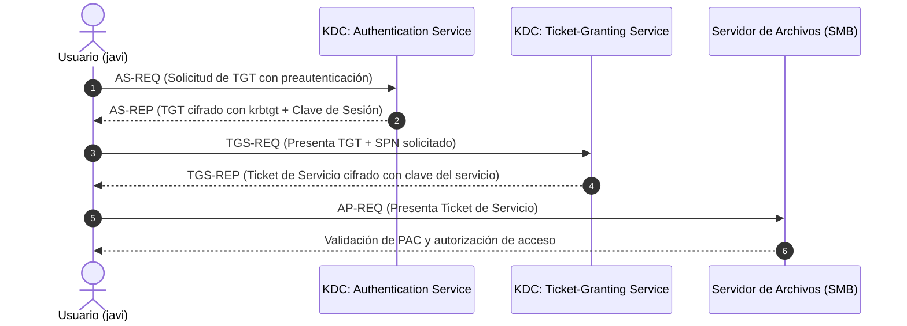

# ¿Cómo Funciona Kerberos?

Guía comprensiva sobre el funcionamiento interno de **Kerberos**, el protocolo de autenticación predeterminado en entornos de red basados en **Active Directory**: entidades participantes, estructura del KDC, ciclo de vida de los tickets y analogías prácticas.

---

## Introducción a Kerberos

Kerberos es un protocolo de autenticación mutua de red basado en criptografía de clave simétrica y en un tercero de confianza denominado **KDC (Key Distribution Center)**. Su premisa fundamental es **no transmitir contraseñas en texto claro a través de la red**, utilizando en su lugar un sistema de **tickets cifrados** con marcas de tiempo para validar identidades y autorizar accesos.

El flujo de intercambio de tickets se estructura de la siguiente manera:

Esquema de referencia del protocolo:

---

## Los 4 Protagonistas Clave de Kerberos

Para comprender el flujo, es fundamental identificar a los cuatro actores principales:

1. **El Cliente (Usuario o Equipo)**: La entidad que solicita autenticarse en el dominio y acceder a un recurso compartido o servicio de red.
2. **El KDC (Key Distribution Center)**: El servicio central que reside en los Controladores de Dominio (DC) y gestiona la emisión, validación y sellado criptográfico de todos los tickets.
3. **El Ticket**: La credencial digital temporal cifrada que acredita la identidad y membresías del usuario ante el KDC o ante un servicio específico.
4. **El Servicio de Destino (Resource Server)**: El servidor o aplicación final (compartición SMB, base de datos MSSQL, servidor web IIS, servicio WinRM) al que el cliente desea conectarse.

---

## Arquitectura Interna del KDC

El KDC no es necesariamente un servidor físico independiente, sino un conjunto de servicios que se ejecutan de forma nativa en cada Controlador de Dominio de Active Directory:

El KDC se compone principalmente de:

1. **AS (Authentication Service)**:  
   Es el servicio de autenticación inicial. Recibe la petición del usuario (`AS-REQ`), valida su identidad mediante la preautenticación y le entrega un **TGT (Ticket-Granting Ticket)** (`AS-REP`).

2. **TGS (Ticket-Granting Service)**:  
   Es el servicio emisor de tickets para recursos específicos. Recibe el TGT presentado por el usuario (`TGS-REQ`), comprueba su validez y emite un **Ticket de Servicio** cifrado con la clave del servicio de destino (`TGS-REP`).

3. **Base de Datos NTDS.dit**:  
   El almacén central de Active Directory donde residen las cuentas, atributos y claves secretas (hashes derivados de las contraseñas) de todos los usuarios, máquinas, servicios y de la cuenta especial `krbtgt`.

4. **El PAC (Privilege Attribute Certificate)**:  
   Es una estructura de datos generada por el KDC e insertada dentro del ticket Kerberos. Contiene el SID del usuario, los SIDs de los grupos a los que pertenece y los privilegios asignados. El PAC está firmado criptográficamente por el KDC (firma del servidor y firma del KDC) para evitar que el cliente pueda alterar sus permisos.

---

## Ciclo de Autenticación Paso a Paso (Ejemplo Práctico)

> **Escenario:** El usuario `javi` necesita acceder a una carpeta compartida por SMB (`CIFS/fileserver.domain.com`) en un servidor de la empresa.

### 1. AS-REQ $\rightarrow$ AS-REP (Solicitud y entrega del TGT)
* **Petición (`AS-REQ`):** El cliente cifra una marca de tiempo actual con la clave derivada de su contraseña y la envía al KDC.
* **Respuesta (`AS-REP`):** El KDC descifra el timestamp con el hash almacenado en `NTDS.dit`. Si es válido, emite el **TGT (Ticket-Granting Ticket)**, el cual va cifrado con el hash secreto de la cuenta **`krbtgt`**, además de una clave de sesión compartida.
* *Analogía:* Te presentas en la recepción de un edificio con tu documento de identidad y te entregan una tarjeta de visitante general.

### 2. TGS-REQ $\rightarrow$ TGS-REP (Solicitud del Ticket de Servicio)
* **Petición (`TGS-REQ`):** El cliente presenta su TGT intacto al KDC junto con el identificador del servicio al que desea acceder (**SPN - Service Principal Name**, por ejemplo `cifs/fileserver.domain.com`).
* **Respuesta (`TGS-REP`):** El TGS descifra el TGT utilizando la clave de `krbtgt`, comprueba la vigencia y genera un **Ticket de Servicio (TGS)** cifrado con la clave secreta de la cuenta bajo la cual corre el servicio de destino.
* *Analogía:* Presentas tu tarjeta de visitante general en el mostrador del departamento y solicitas un pase para ingresar a la sala de contabilidad.

### 3. AP-REQ (Presentación del ticket al Servidor Final)
* **Petición (`AP-REQ`):** El cliente se conecta directamente al servidor de archivos y le entrega el Ticket de Servicio.
* *Analogía:* Muestras el pase específico en la puerta de la sala de contabilidad para que te permitan entrar.

### 4. Validación y Autorización
* El servidor de archivos descifra el ticket utilizando su propia clave secreta (hash de su cuenta de máquina o cuenta de servicio).
* Extrae el **PAC**, inspecciona los grupos del usuario y decide si sus permisos (NTFS / Share permissions) le autorizan a abrir la carpeta.
* *Analogía:* El guardia de la sala comprueba que el pase tenga el sello auténtico y revisa si estás en la lista de personas autorizadas a manipular los expedientes.

---

## Terminología de Mensajes Kerberos

| Mensaje | Función Técnica | Significado en Palabras Sencillas |
| :--- | :--- | :--- |
| **`AS-REQ`** | *Authentication Service Request* | Petición inicial de inicio de sesión enviada al KDC demostrando identidad con preautenticación. |
| **`AS-REP`** | *Authentication Service Response* | Respuesta del KDC con el Ticket-Granting Ticket (**TGT**) y la clave de sesión inicial. |
| **`TGS-REQ`** | *Ticket-Granting Service Request* | Solicitud enviada al KDC presentando el TGT para solicitar acceso a un servicio específico (**SPN**). |
| **`TGS-REP`** | *Ticket-Granting Service Response* | Entrega del **Ticket de Servicio** cifrado con la clave del recurso solicitado. |
| **`AP-REQ`** | *Application Request* | Entrega del Ticket de Servicio por parte del cliente al servidor final de la aplicación. |
| **`AP-REP`** | *Application Response* | Confirmación opcional de autenticación mutua enviada por el servidor al cliente. |

---

## Diferencia Fundamental: TGT vs. Ticket de Servicio

* **TGT (Ticket-Granting Ticket)**:
  * Cifrado con la clave de la cuenta **`krbtgt`**.
  * Solo el KDC puede leerlo y descifrarlo.
  * Funciona como la acreditación de identidad general para solicitar tickets posteriores.
* **Ticket de Servicio (TGS)**:
  * Cifrado con la clave de la **cuenta que ejecuta el servicio** (cuenta de máquina `SERVER$` o cuenta de servicio `svc_app`).
  * Solo el servidor de destino puede descifrarlo.
  * Es el pase específico para interactuar con esa aplicación concreta.

> [!IMPORTANT]
> **Autenticación no equivale a Autorización:**  
> Poseer un ticket de servicio válido demuestra quién eres ante el servidor de destino (**Autenticación**), pero los privilegios efectivos dentro de la aplicación dependerán de las listas de control de acceso (ACLs) y directivas del recurso (**Autorización**).
